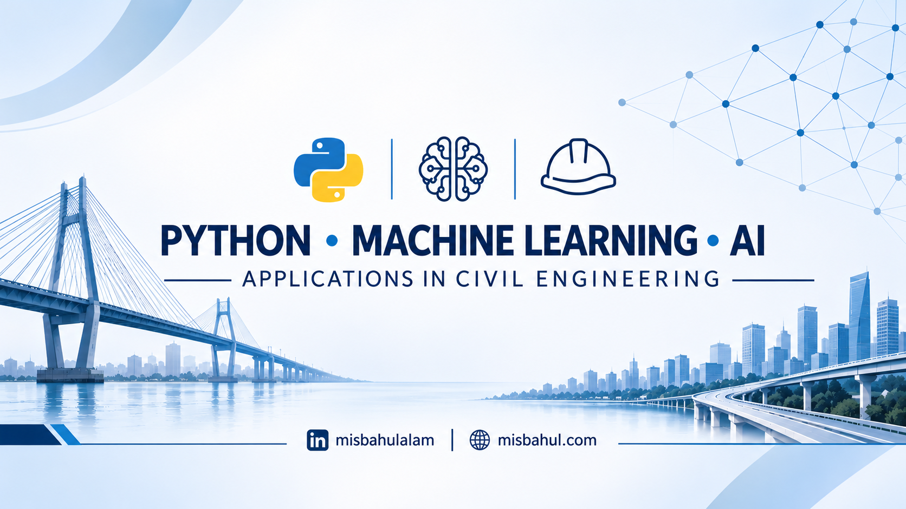

# Python, Machine Learning & AI for Civil Engineering

  

  <strong>Building a foundation in Python, Machine Learning, and Artificial Intelligence to solve real-world Civil Engineering problems.</strong>

  
  
  
  

---

## About This Repository

This repository documents my learning journey from Python programming to Machine Learning and Artificial Intelligence, focusing on practical applications in Civil Engineering.

As a Civil Engineering undergraduate, I am particularly interested in exploring how AI and data-driven methods can improve structural analysis, infrastructure safety, transportation systems, and engineering decision-making.

My goal is to develop the programming, mathematical, analytical, and research skills needed to build practical AI-based solutions for real-world Civil Engineering challenges.

## Learning Roadmap

My learning journey is organized into seven phases over 112 study days.

| Phase | Topics | Days |
|:---:|---|:---:|
| 01 | Python Fundamentals | 01–14 |
| 02 | Intermediate Python | 15–28 |
| 03 | Mathematics & Data Analysis | 29–49 |
| 04 | Machine Learning Fundamentals | 50–70 |
| 05 | Deep Learning & AI | 71–84 |
| 06 | AI Applications in Civil Engineering | 85–98 |
| 07 | Research, Projects & Career | 99–112 |

### 🟦 Phase 01 — Python Fundamentals
**Days 01–14**

- Algorithms, variables and data types
- Operators, input and type conversion
- Comparison and logical operators
- Conditional statements
- For and while loops
- Functions and strings
- Lists, tuples and sets
- Dictionaries and nested data structures
- Problem-solving practice

**Mini-Project:** Concrete Strength Calculator

### 🟩 Phase 02 — Intermediate Python
**Days 15–28**

- Practical use of Python functions
- File handling
- Reading and writing CSV files
- Working with engineering data
- Exception handling
- Debugging Python code
- Object-Oriented Programming
- Classes and objects
- Organizing Python programs
- Engineering data management

**Mini-Project:** Engineering Data Management System

### 🟨 Phase 03 — Mathematics & Data Analysis
**Days 29–49**

- NumPy and numerical computation
- Arrays, indexing and mathematical operations
- Pandas and DataFrames
- Reading and processing engineering datasets
- Data cleaning and filtering
- Matplotlib and data visualization
- Descriptive statistics
- Probability and distribution basics
- Correlation and essential linear algebra

**Planned Projects:**
- Concrete Strength Data Analysis
- Traffic Volume Visualization
- Concrete Ingredients vs. Compressive Strength Analysis

### 🟧 Phase 04 — Machine Learning Fundamentals
**Days 50–70**

- Introduction to Machine Learning
- Supervised and Unsupervised Learning
- Features, targets and datasets
- Data preprocessing
- Training and testing datasets
- Scikit-learn
- Linear and Multiple Linear Regression
- Model prediction and evaluation
- MAE, MSE, RMSE and R² Score
- Feature scaling and categorical encoding
- Classification and Logistic Regression
- Decision Trees
- Confusion Matrix, Precision, Recall and F1-score
- Overfitting, underfitting and cross-validation

**Planned Projects:**
- Concrete Compressive Strength Prediction
- Soil Classification
- Traffic Congestion Classification

### 🟥 Phase 05 — Deep Learning & Artificial Intelligence
**Days 71–84**

- Introduction to Neural Networks
- Neurons, layers and weights
- Activation and loss functions
- Model training and backpropagation
- PyTorch or TensorFlow
- Building a simple neural network
- Introduction to Computer Vision
- Image processing with OpenCV
- Image classification
- Convolutional Neural Networks (CNN)
- Transfer Learning
- Object Detection
- YOLO fundamentals

**Mini-Project:** Concrete Crack Detection using Computer Vision

### 🟪 Phase 06 — AI Applications in Civil Engineering
**Days 85–98**

**Structural Engineering**
- Artificial Intelligence in Structural Engineering
- Structural Health Monitoring (SHM)
- Sensor data analysis
- AI-based crack detection
- Bridge condition monitoring
- Concrete strength prediction

**Transportation Engineering**
- Artificial Intelligence in Transportation Engineering
- Traffic data analysis
- Traffic volume prediction
- Traffic congestion classification
- Vehicle detection using Computer Vision
- Smart traffic control fundamentals

**Planned Projects:**
- Bridge Condition Monitoring
- Concrete Crack Detection
- Traffic Volume Prediction
- Intelligent Traffic Management

### 🟫 Phase 07 — Research, Projects & Career
**Days 99–112**

- Introduction to AI research in Civil Engineering
- Reading and understanding research papers
- Research methodology
- Finding engineering datasets
- Research problem selection
- Structural Engineering research topics
- Transportation Engineering research topics
- Working with real engineering datasets
- Improving Machine Learning projects
- Model validation and limitations
- GitHub project documentation
- AI-for-Civil portfolio development
- Research direction and future learning
- Final project review

---

## Project Portfolio

This section will showcase practical projects developed throughout my learning journey.

Each completed project will include its problem statement, dataset, methodology, implementation, results, and limitations.

| Project | Application |
|---|---|
| Concrete Strength Calculator | Python / Structural Engineering |
| Engineering Data Management System | Python |
| Concrete Strength Data Analysis | Data Analysis |
| Traffic Volume Visualization | Transportation Engineering |
| Concrete Strength Prediction | Machine Learning |
| Soil Classification | Geotechnical Engineering |
| Concrete Crack Detection | Computer Vision |
| Traffic Volume Prediction | Transportation Engineering |
| Bridge Condition Monitoring | Structural Engineering |
| Intelligent Traffic Management | AI / Transportation Engineering |

## Technology Stack

**Currently Learning**
- Python

**Planned Programming Libraries & Frameworks**
- NumPy
- Pandas
- Matplotlib
- Scikit-learn
- TensorFlow / PyTorch
- OpenCV
- YOLO

**Potential Engineering Tools**
- MATLAB
- OpenSees
- SUMO
- GIS Tools

## Areas of Interest

**Structural Engineering**
- Structural Health Monitoring
- AI-based Structural Damage Detection
- Computer Vision for Infrastructure Inspection
- Data-driven Structural Analysis
- Bridge Condition Monitoring

**Transportation Engineering**
- Traffic Flow and Volume Prediction
- Intelligent Transportation Systems
- Traffic Congestion Analysis
- AI-based Road Safety
- Smart Traffic Signal Control

## My Objective

My long-term objective is to combine Civil Engineering knowledge with programming, Machine Learning, and Artificial Intelligence to explore research opportunities and develop practical solutions for infrastructure-related problems.

I am particularly interested in the intersection of Structural Engineering, Transportation Engineering, and AI.

This repository represents my learning process, experiments, projects, and continuous development toward that goal.

---

## Connect

- **GitHub:** [misbahuls](https://github.com/misbahuls)
- **LinkedIn:** [Misbahul Alam](https://www.linkedin.com/in/misbahulalam)
- **Website:** [misbahul.com](https://misbahul.com)

---

  
  
  
  

